# Development Workstation Setup

## 1. Project Overview

본 프로젝트는 Windows 환경에서 개발자용 워크스테이션을 구축하고 Linux CLI, Docker, Git 및 GitHub의 기본적인 사용 방법을 실습하는 것을 목표로 한다.

WSL 2를 통해 Ubuntu Linux 환경을 구성하고 Docker Desktop을 활용하여 컨테이너 기반 개발 환경을 구축하였다.

주요 수행 내용은 다음과 같다.

- Linux CLI를 활용한 파일 및 디렉토리 관리
- Linux 파일 및 디렉토리 권한 확인 및 변경
- Docker 설치 및 컨테이너 실행
- Dockerfile을 활용한 커스텀 웹 서버 이미지 제작
- 포트 매핑을 통한 웹 서버 접속 검증
- 바인드 마운트를 통한 호스트 파일 변경 반영
- Docker 볼륨을 통한 데이터 영속성 검증
- Git 및 GitHub 연동을 통한 소스코드 버전 관리

## 2. Development Environment

| 항목 | 개발 환경 |
|---|---|
| Host OS | Windows |
| Linux Distribution | Ubuntu 24.04.5 LTS |
| Virtualization | WSL 2 |
| Shell | Bash |
| Terminal | Windows PowerShell / WSL |
| Container Platform | Docker Desktop |
| Docker Client | 29.9.2 |
| Docker Server | 29.9.2 |
| Architecture | x86_64 |
| Code Editor | Visual Studio Code |
| Git | 2.43.0 |
| Remote Repository | GitHub |

### 2.1 Environment Verification

Ubuntu 운영체제 확인:

```bash
cat /etc/os-release
```

Shell 확인:

```bash
echo $SHELL
```

Docker 버전 확인:

```bash
docker --version
```

실행 결과:

```text
Docker version 29.9.2, build a82e528
```

Docker 엔진 정보 확인:

```bash
docker info
```

Docker Client와 Docker Server가 정상적으로 연결되는 것을 확인하였다.

Git 버전 확인:

```bash
git --version
```

실행 결과:

```text
git version 2.43.0
```

## 3. Project Structure

```text
dev-workstation/
│
├── README.md
├── Dockerfile
│
├── cli-practice/
│   ├── notes.txt
│   └── permission-file.txt
│
├── site/
│   └── index.html
│
└── screenshots/
    ├── 00-project-setup.png
    ├── 01-terminal-basics.png
    ├── 02-file-operations.png
    ├── 03-file-permissions.png
    ├── 04-development-environment.png
    ├── 05-1-docker-info.png
    ├── 05-2-docker-info.png
    ├── 06-hello-world.png
    ├── 07-ubuntu-container.png
    ├── 08-docker-exec.png
    ├── 09-dockerfile.png
    ├── 10-docker-build.png
    ├── 11-container-running.png
    ├── 12-web-browser.png
    ├── 13-docker-operations.png
    ├── 14-bind-mount-before.png
    ├── 15-bind-mount-after.png
    ├── 16-volume-before.png
    ├── 17-volume-after.png
    ├── 18-git-config.png
    ├── 19-vscode-github-integration.png
    └── 20-github-repository.png
```

## 4. Linux Terminal Practice

Linux CLI를 활용하여 디렉토리 및 파일 관리 작업을 수행하였다.

### 4.1 현재 위치 및 파일 목록 확인

```bash
pwd
ls
ls -la
```

### 4.2 디렉토리 생성 및 이동

```bash
mkdir cli-practice
cd cli-practice
pwd
```

### 4.3 파일 생성 및 내용 확인

```bash
touch notes.txt

echo "My Development Workstation" > notes.txt

cat notes.txt
```

### 4.4 파일 복사, 이동, 이름 변경 및 삭제

```bash
cp notes.txt backup.txt

mkdir archive

mv backup.txt archive/

mv archive/backup.txt archive/final.txt

ls -la archive

rm archive/final.txt
```

### 4.5 절대 경로와 상대 경로

절대 경로는 최상위 디렉토리부터 파일까지의 전체 경로를 의미하며, 상대 경로는 현재 작업 디렉토리를 기준으로 파일 위치를 지정하는 방식이다.

```bash
cat notes.txt

cat ~/dev-workstation/cli-practice/notes.txt
```

두 명령어 모두 동일한 파일에 접근한다.

**Verification Evidence**

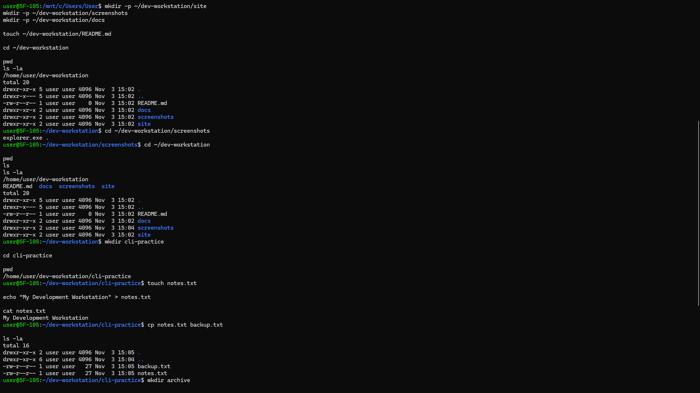

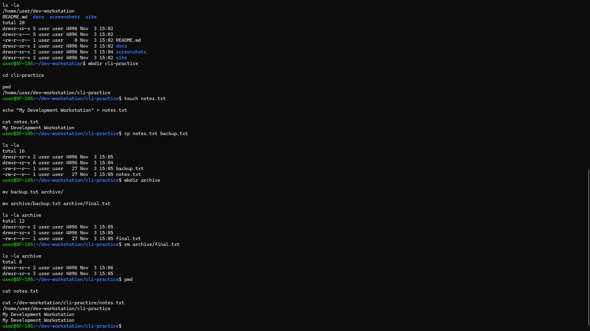

## 5. Linux File Permissions

Linux 파일 및 디렉토리의 접근 권한을 확인하고 변경하였다.

### 5.1 실습 파일 생성

```bash
touch permission-file.txt

mkdir permission-dir
```

### 5.2 변경 전 권한

```bash
chmod 600 permission-file.txt

chmod 700 permission-dir

echo "BEFORE PERMISSION CHANGE"

ls -l permission-file.txt

ls -ld permission-dir
```

실행 결과:

```text
-rw------- permission-file.txt
drwx------ permission-dir
```

### 5.3 권한 변경 후 확인

```bash
chmod 644 permission-file.txt

chmod 755 permission-dir

echo "AFTER PERMISSION CHANGE"

ls -l permission-file.txt

ls -ld permission-dir
```

실행 결과:

```text
-rw-r--r-- permission-file.txt
drwxr-xr-x permission-dir
```

### 5.4 Linux Permission 설명

| 권한 | 의미 | 숫자 |
|---|---|---|
| r | Read | 4 |
| w | Write | 2 |
| x | Execute | 1 |

- 644: 소유자는 읽기와 쓰기 권한을 가지며, 그룹 및 기타 사용자는 읽기 권한을 가진다.
- 755: 소유자는 읽기, 쓰기 및 실행 권한을 가지며, 그룹 및 기타 사용자는 읽기 및 실행 권한을 가진다.

권한 변경을 통해 파일과 디렉토리의 접근 권한을 관리하는 방법을 확인하였다.

**Verification Evidence**

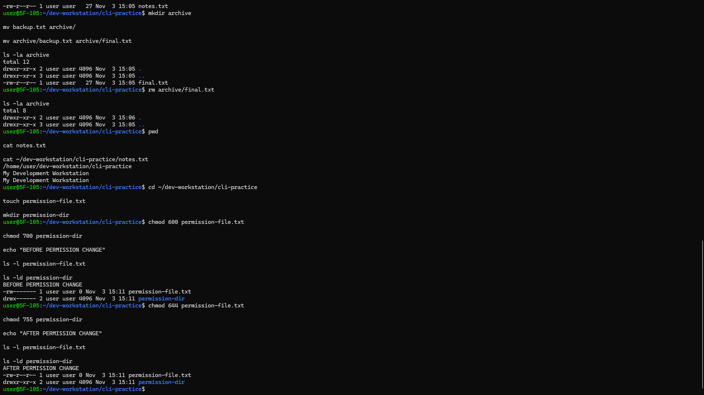

## 6. Docker Installation and Verification

Docker Desktop의 WSL 2 백엔드를 활용하여 Docker 실행 환경을 구성하였다.

### 6.1 Docker Version

```bash
docker --version
```

실행 결과:

```text
Docker version 29.9.2, build a82e528
```

### 6.2 Docker Engine Verification

```bash
docker info
```

Docker Client와 Docker Server가 정상적으로 연결되는 것을 확인하였다.

주요 확인 항목:

- Docker Server Version: 29.9.2
- Operating System: Docker Desktop
- Architecture: x86_64
- CPUs: 8
- Total Memory: 약 7.625 GiB

**Verification Evidence**

Docker 엔진 정보는 두 장의 스크린샷으로 기록하였다.

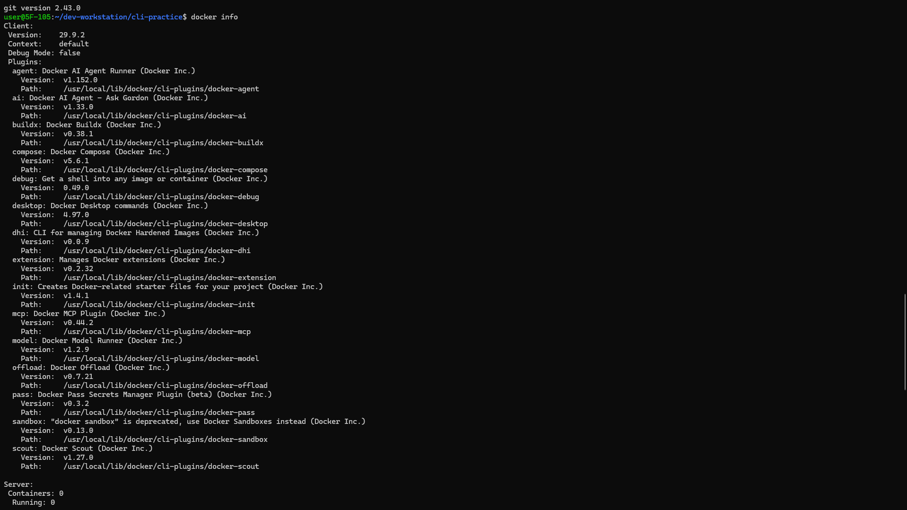

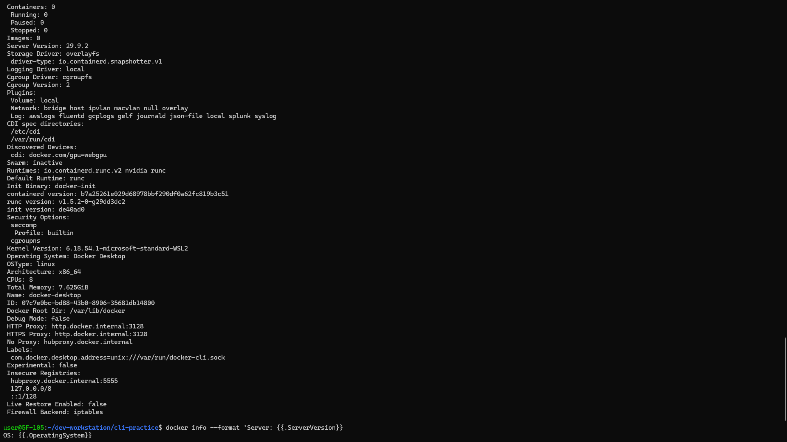

### 6.3 Hello World Container

```bash
docker run hello-world
```

실행 결과:

```text
Hello from Docker!

This message shows that your installation
appears to be working correctly.
```

Docker Hub에서 이미지를 다운로드하고 컨테이너를 생성 및 실행하는 과정을 확인하였다.

**Verification Evidence**

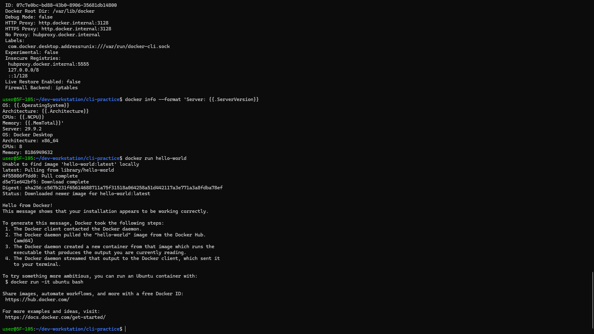

## 7. Docker Container Practice

### 7.1 Ubuntu Container 실행

```bash
docker run -it \
  --name mission-ubuntu-interactive \
  ubuntu:24.04 bash
```

컨테이너 내부에서 다음 명령어를 실행하였다.

```bash
pwd

ls -la

echo "Hello from my Ubuntu container"

exit
```

컨테이너 종료 후 상태를 확인하였다.

```bash
docker ps -a --filter name=mission-ubuntu-interactive
```

컨테이너가 Exited 상태로 변경된 것을 확인하였다.

### 7.2 Docker Exec 실습

백그라운드 컨테이너 실행:

```bash
docker run -d \
  --name mission-ubuntu-background \
  ubuntu:24.04 sleep infinity
```

컨테이너 내부 진입:

```bash
docker exec -it mission-ubuntu-background bash
```

컨테이너 내부 명령어:

```bash
echo "Testing Docker exec"

exit
```

컨테이너 상태 확인:

```bash
docker ps --filter name=mission-ubuntu-background
```

컨테이너 중지:

```bash
docker stop mission-ubuntu-background

docker ps -a --filter name=mission-ubuntu-background
```

`docker exec`는 실행 중인 컨테이너에 별도의 프로세스를 실행한다. 해당 프로세스에서 `exit`을 입력해도 메인 프로세스가 계속 실행 중이라면 컨테이너는 유지된다.

반면 메인 프로세스가 종료되거나 `docker stop`을 실행하면 컨테이너가 중지된다.

**Verification Evidence**

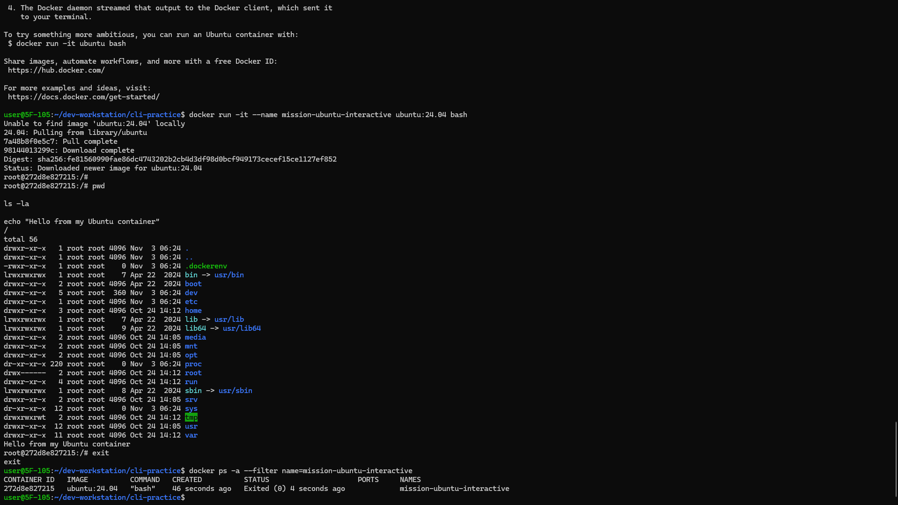

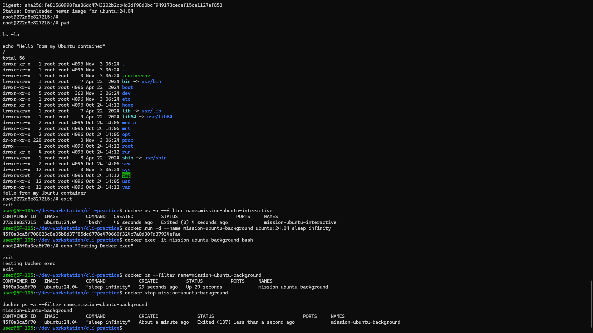

## 8. Custom Docker Image

기존 NGINX Alpine 이미지를 베이스 이미지로 활용하여 커스텀 웹 서버를 제작하였다.

### 8.1 Base Image

```dockerfile
FROM nginx:alpine
```

### 8.2 Dockerfile

```dockerfile
FROM nginx:alpine

LABEL org.opencontainers.image.title="my-custom-web"

ENV APP_ENV=development

COPY site/ /usr/share/nginx/html/

EXPOSE 80
```

### 8.3 Dockerfile Customization

| 명령어 | 목적 |
|---|---|
| FROM | NGINX Alpine 베이스 이미지 지정 |
| LABEL | 이미지 식별 정보 추가 |
| ENV | 개발 환경 변수 설정 |
| COPY | 직접 작성한 웹페이지를 이미지 내부로 복사 |
| EXPOSE | 컨테이너 서비스 포트 명시 |

### 8.4 Web Server Source Code

`site/index.html`

최초 커스텀 이미지 빌드에 사용한 웹페이지:

```html
<!DOCTYPE html>
<html lang="en">
<head>
    <meta charset="UTF-8">
    <title>My Development Workspace</title>
</head>
<body>
    <h1>Hello, Docker!</h1>
    <p>This is my first custom web server.</p>
</body>
</html>
```

이후 바인드 마운트 실습을 위해 호스트의 `site/index.html`을 수정하였다.

### 8.5 Docker Image Build

```bash
docker build -t mission-web:1.0 .
```

빌드된 이미지 확인:

```bash
docker images
```

커스텀 이미지 `mission-web:1.0`을 생성하였다.

**Verification Evidence**

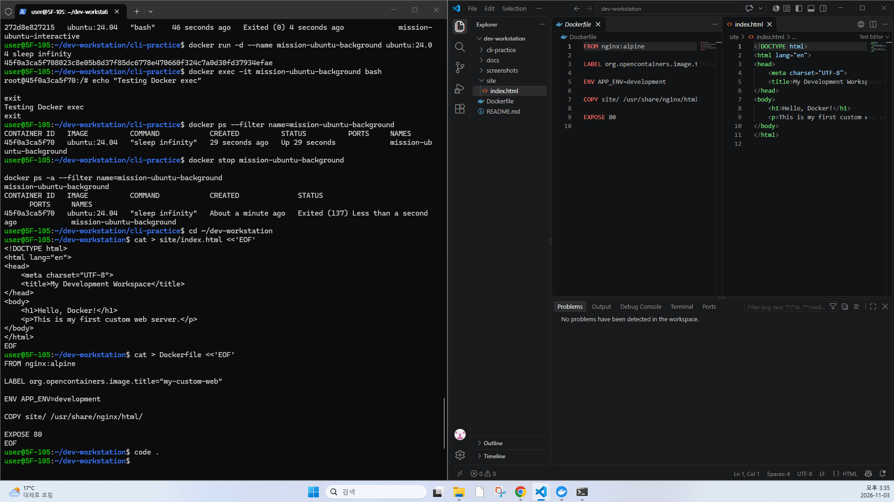

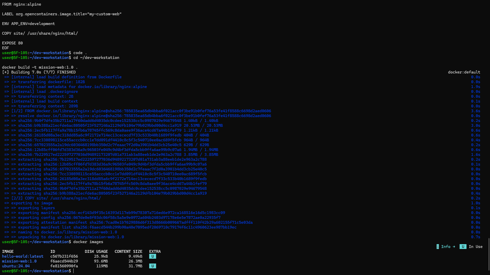

## 9. Port Mapping and Web Server Access

### 9.1 Container 실행

```bash
docker run -d \
  --name mission-web \
  -p 8080:80 \
  mission-web:1.0
```

### 9.2 Container 상태 확인

```bash
docker ps
```

호스트 포트 8080과 컨테이너 포트 80이 연결된 것을 확인하였다.

### 9.3 Browser Access

웹 브라우저에서 다음 주소에 접속하였다.

```text
http://localhost:8080
```

실행 결과:

```text
Hello, Docker!

This is my first custom web server.
```

### 9.4 Port Mapping 설명

`-p 8080:80`은 호스트의 8080 포트와 컨테이너의 80 포트를 연결하는 설정이다.

이를 통해 호스트 컴퓨터의 웹 브라우저에서 컨테이너 내부 웹 서버에 접근할 수 있다.

**Verification Evidence**

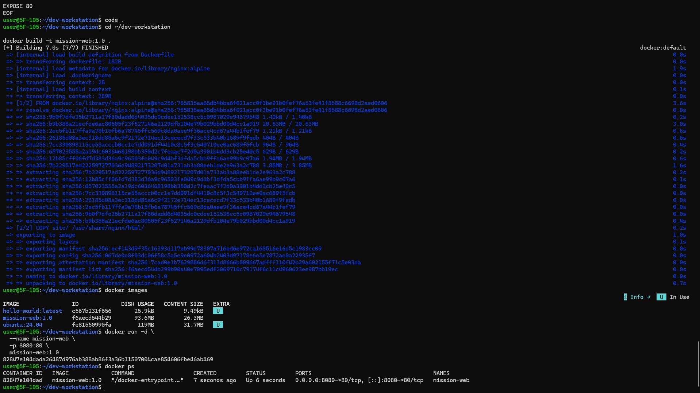

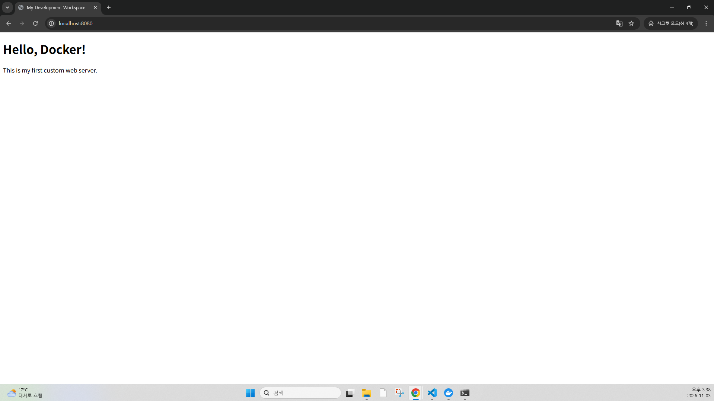

## 10. Docker Operations

Docker 이미지, 컨테이너, 로그 및 리소스 확인 명령어를 실습하였다.

### 10.1 Images

```bash
docker images
```

### 10.2 Containers

```bash
docker ps

docker ps -a
```

### 10.3 Container Logs

```bash
docker logs mission-web
```

### 10.4 Resource Usage

```bash
docker stats --no-stream mission-web
```

각 명령어를 통해 이미지 목록, 컨테이너 실행 상태, 로그 및 리소스 사용량을 확인하였다.

**Verification Evidence**

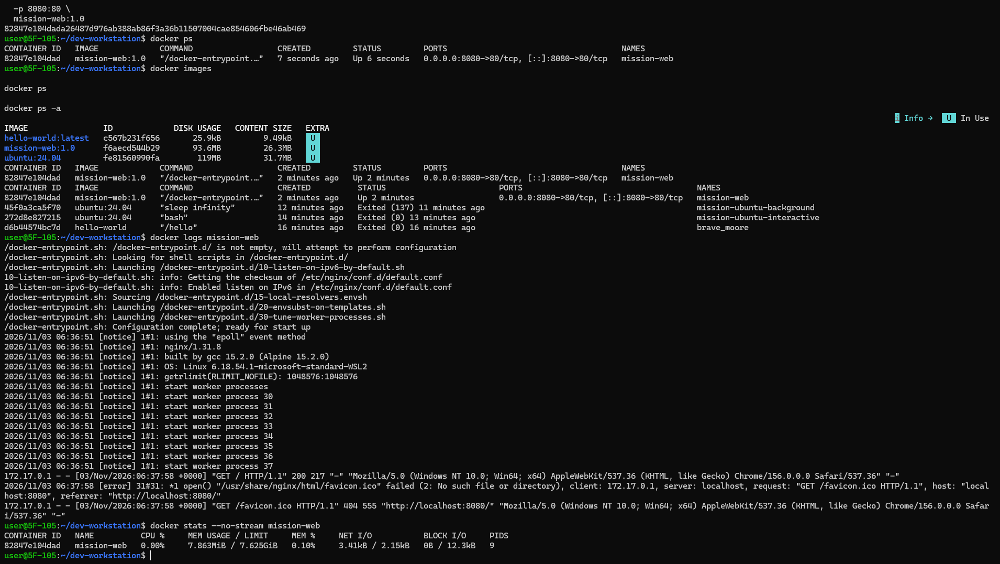

## 11. Bind Mount Verification

바인드 마운트를 활용하여 호스트 컴퓨터의 파일 변경 사항이 컨테이너에 반영되는 것을 검증하였다.

### 11.1 Bind Mount Container 실행

```bash
cd ~/dev-workstation

docker run -d \
  --name mission-bind-web \
  -p 8081:80 \
  -v "$PWD/site:/usr/share/nginx/html:ro" \
  nginx:alpine
```

### 11.2 변경 전 확인

브라우저 접속:

```text
http://localhost:8081
```

기존 웹페이지의 내용을 확인하였다.

### 11.3 호스트 파일 수정

호스트 컴퓨터의 `site/index.html` 파일을 다음과 같이 수정하였다.

```html
<!DOCTYPE html>
<html lang="en">
<head>
    <meta charset="UTF-8">
    <title>Updated Page</title>
</head>
<body>
    <h1>Updated without rebuilding Docker!</h1>
    <p>Bind mount works successfully.</p>
</body>
</html>
```

### 11.4 변경 후 확인

브라우저를 새로고침하여 수정된 내용을 확인하였다.

Docker 이미지를 다시 빌드하지 않고도 호스트 파일의 변경 사항이 컨테이너에 반영되었다.

### 11.5 Bind Mount 설명

바인드 마운트는 호스트 컴퓨터의 특정 경로를 컨테이너 내부의 경로에 연결하는 기능이다.

이번 실습에서는 `:ro` 옵션을 사용하여 컨테이너에서 해당 마운트 경로를 읽기 전용으로 연결하였다.

호스트에서 파일을 수정하면 컨테이너에서도 변경 사항을 확인할 수 있다.

**Verification Evidence**

변경 전:

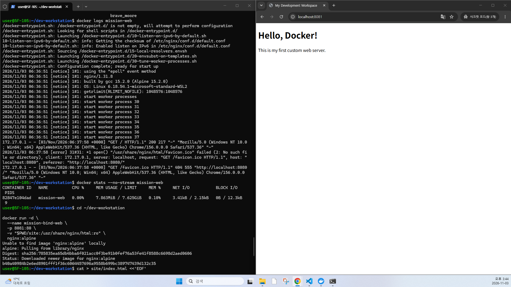

변경 후:

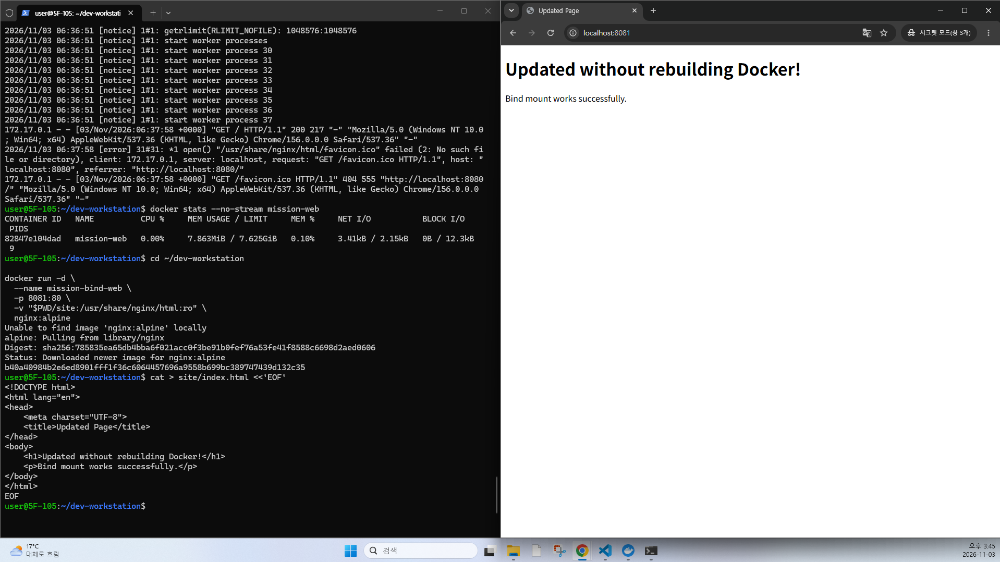

## 12. Docker Volume Persistence

Docker 볼륨을 생성하고 컨테이너에 연결하여 데이터 영속성을 검증하였다.

### 12.1 Volume 생성

```bash
docker volume create mission-data

docker volume ls
```

### 12.2 Volume을 연결한 Container 실행

```bash
docker run -d \
  --name mission-volume-before \
  -v mission-data:/data \
  ubuntu:24.04 sleep infinity
```

### 12.3 데이터 생성 및 확인

```bash
docker exec mission-volume-before bash -lc \
'echo "Persistent data test" > /data/message.txt && cat /data/message.txt'
```

실행 결과:

```text
Persistent data test
```

### 12.4 기존 Container 삭제

```bash
docker rm -f mission-volume-before
```

### 12.5 새로운 Container에서 데이터 확인

```bash
docker run --rm \
  --name mission-volume-after \
  -v mission-data:/data \
  ubuntu:24.04 \
  cat /data/message.txt
```

실행 결과:

```text
Persistent data test
```

기존 컨테이너를 삭제하고 새로운 컨테이너를 생성한 후에도 동일한 데이터가 유지되는 것을 확인하였다.

### 12.6 Volume 설명

Docker Volume은 컨테이너와 독립적으로 데이터를 저장하는 기능이다.

컨테이너가 삭제되더라도 볼륨 자체가 삭제되지 않는 한 저장된 데이터를 유지할 수 있다.

**Verification Evidence**

데이터 저장 및 기존 컨테이너:

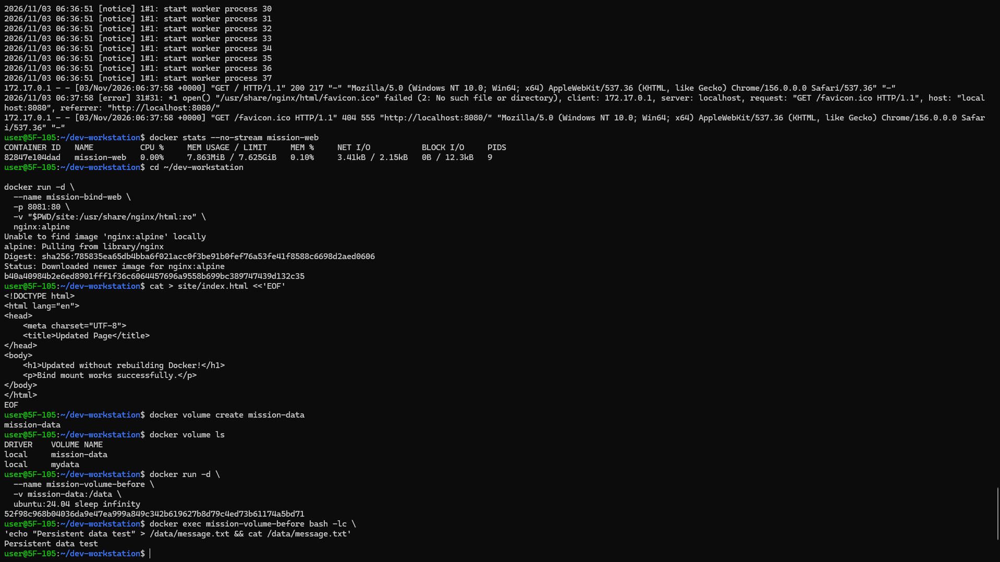

기존 컨테이너 삭제 후 데이터 확인:

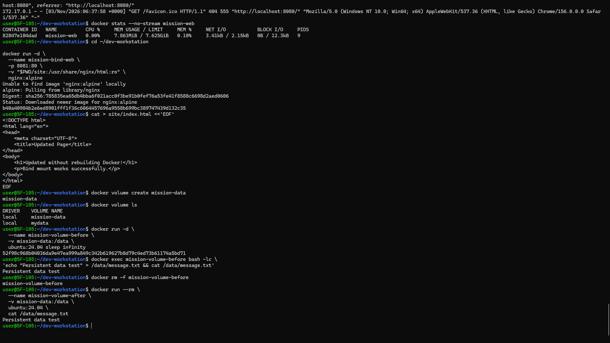

## 13. Git and GitHub Integration

Git을 사용하여 로컬 프로젝트의 버전을 관리하고 GitHub에 원격 저장소를 연결하였다.

### 13.1 Git 사용자 정보 및 기본 브랜치 설정

```bash
git config --global user.name "kyunghoonyoo"

git config --global init.defaultBranch main
```

Git 이메일 정보도 별도로 설정하였으며, 개인정보 보호를 위해 공개 문서에는 이메일 주소를 기재하지 않았다.

설정 확인:

```bash
git config --list
```

### 13.2 Git Repository 초기화

```bash
git init

git branch -M main

git add .

git commit -m "Complete development workstation mission"
```

### 13.3 GitHub Repository 연결

GitHub Repository:

https://github.com/kyunghoonyoo/dev-workstation

원격 저장소 확인:

```bash
git remote -v
```

현재 브랜치 확인:

```bash
git branch --show-current
```

원격 저장소에 업로드:

```bash
git push -u origin main
```

### 13.4 GitHub Authentication

HTTPS 방식의 Git 작업을 위해 GitHub CLI를 사용하여 브라우저 기반 인증을 진행하였다.

```bash
gh auth login

gh auth status

gh auth setup-git
```

인증 완료 후 GitHub 원격 저장소에 정상적으로 Push할 수 있었다.

### 13.5 Git과 GitHub의 차이

- Git: 로컬 컴퓨터에서 소스코드의 변경 사항과 버전을 관리하는 분산 버전 관리 시스템이다.
- GitHub: Git 저장소를 원격으로 호스팅하고 프로젝트 공유 및 협업을 지원하는 플랫폼이다.

### 13.6 VS Code and GitHub Integration

Visual Studio Code에서 GitHub 계정으로 로그인하고 프로젝트 저장소를 열었다.

Source Control 패널에서 Git 저장소를 확인하고 통합 터미널에서 원격 저장소 주소, 브랜치 및 Git 상태를 확인하였다.

**Verification Evidence**

VS Code GitHub 로그인 및 Source Control 통합 화면:

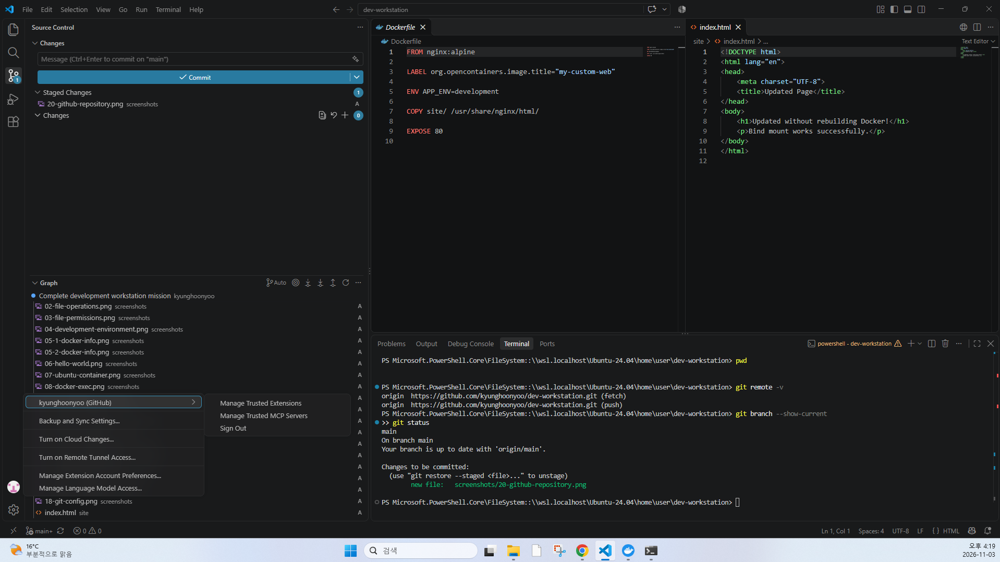

GitHub Repository:

https://github.com/kyunghoonyoo/dev-workstation

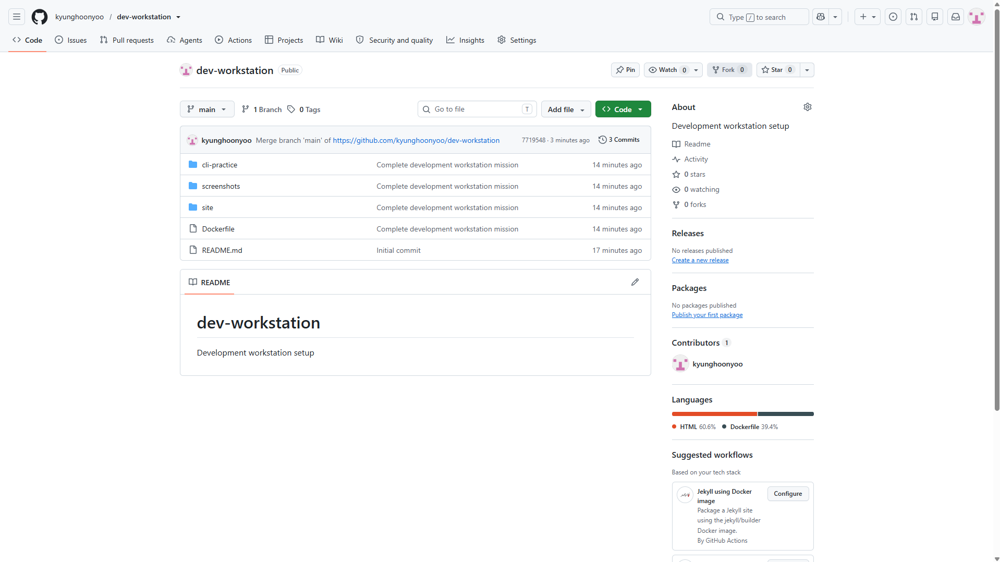

## 14. Troubleshooting

실습 과정에서 발생한 문제와 해결 과정을 정리하였다.

### 14.1 WSL Update HTTP 403 Error

**Problem**

WSL 업데이트 실행 중 HTTP 403 오류가 발생하였다.

```text
사용 권한 없음(403).
오류 코드: Wsl/UpdatePackage/HTTP_E_STATUS_FORBIDDEN
```

**Cause Hypothesis**

WSL 업데이트 패키지 다운로드 과정에서 네트워크 정책 또는 업데이트 서버 접근이 제한되었을 가능성이 있다.

**Verification**

```powershell
wsl --list --verbose
```

Ubuntu-24.04가 WSL Version 2로 설치되어 실행되는 것을 확인하였다.

추가로 Docker Client와 Server가 정상적으로 연결되고 Docker 컨테이너가 실행되는 것을 확인하였다.

**Resolution / Alternative**

WSL 업데이트 오류의 정확한 발생 원인은 확인하지 못하였다. 기존 WSL 2 환경에서 Docker가 정상적으로 작동하는 것을 확인하여 해당 환경을 활용해 실습을 진행하였다.

### 14.2 Docker Container Name Conflict

**Problem**

Ubuntu 컨테이너 실행 시 기존 컨테이너 이름과 충돌하였다.

```text
The container name "/ubuntu-lab" is already in use
```

**Cause**

동일한 이름을 가진 컨테이너가 이미 존재하였다.

**Verification**

```bash
docker ps -a
```

**Resolution**

기존 컨테이너를 임의로 삭제하지 않고 새로운 고유 이름을 사용하였다.

```bash
docker run -it \
  --name mission-ubuntu-interactive \
  ubuntu:24.04 bash
```

이를 통해 기존 컨테이너와의 이름 충돌을 방지하였다.

### 14.3 GitHub Authentication Failed

**Problem**

GitHub Push 과정에서 계정 비밀번호 인증이 거부되었다.

```text
Invalid username or token.
Password authentication is not supported for Git operations.
```

**Cause**

GitHub는 HTTPS Git 작업에서 일반 계정 비밀번호를 이용한 인증을 지원하지 않는다.

**Resolution**

GitHub CLI를 설치하고 브라우저 기반 인증을 진행하였다.

```bash
gh auth login

gh auth status

gh auth setup-git
```

인증 완료 후 Git Push를 다시 진행하였다.

### 14.4 Git Push Rejected

**Problem**

로컬 저장소를 GitHub에 Push할 때 원격 저장소의 기존 커밋으로 인해 업로드가 거부되었다.

```text
Updates were rejected because the remote contains work
that you do not have locally.
```

**Cause**

GitHub 원격 저장소에 로컬 저장소에 존재하지 않는 별도의 커밋이 있었다.

**Resolution**

원격 저장소의 기록을 가져와 로컬 저장소와 병합하였다.

```bash
git pull --no-rebase origin main --allow-unrelated-histories
```

병합을 완료한 후 다시 Push하였다.

```bash
git push -u origin main
```

이를 통해 로컬 저장소와 원격 저장소의 기록을 통합하였다.

## 15. Final Verification Checklist

- [x] Linux CLI 기본 명령어 실습
- [x] 디렉토리 생성 및 이동
- [x] 파일 생성, 내용 확인, 복사, 이동, 삭제
- [x] 절대 경로와 상대 경로 이해
- [x] 파일 권한 확인 및 변경
- [x] Docker 버전 확인
- [x] Docker 엔진 상태 확인
- [x] hello-world 실행
- [x] Ubuntu 컨테이너 실행 및 내부 명령어 실습
- [x] Docker 컨테이너 실행 및 종료 방식 확인
- [x] Docker 이미지 및 컨테이너 운영 명령어
- [x] Dockerfile 직접 작성
- [x] NGINX 기반 커스텀 이미지 빌드
- [x] 컨테이너 실행
- [x] 포트 매핑 및 브라우저 접속 검증
- [x] 바인드 마운트 변경 사항 반영 검증
- [x] Docker 볼륨 데이터 영속성 검증
- [x] Git 사용자 정보 및 기본 브랜치 설정
- [x] GitHub 원격 저장소 연결
- [x] VS Code GitHub 로그인 및 저장소 연동
- [x] 수행 결과 및 스크린샷 정리
- [x] 트러블슈팅 기록

## 16. Conclusion

이번 미션을 통해 Windows 환경에서 WSL 2와 Ubuntu를 활용한 Linux 개발 환경을 구축하고 Docker 및 GitHub를 이용한 기본적인 개발 워크플로를 실습하였다.

특히 Docker 이미지와 컨테이너의 차이, 포트 매핑, 바인드 마운트 및 볼륨의 데이터 영속성을 직접 검증하였다.

또한 Git을 활용한 로컬 버전 관리와 GitHub를 통한 원격 저장소 연동을 경험하였다.

이번 실습을 통해 재현 가능한 개발 환경을 구축하고 실행 결과를 검증하며 기술 문서로 정리하는 기본적인 개발 역량을 익힐 수 있었다.

---

**GitHub Repository:**  
https://github.com/kyunghoonyoo/dev-workstation