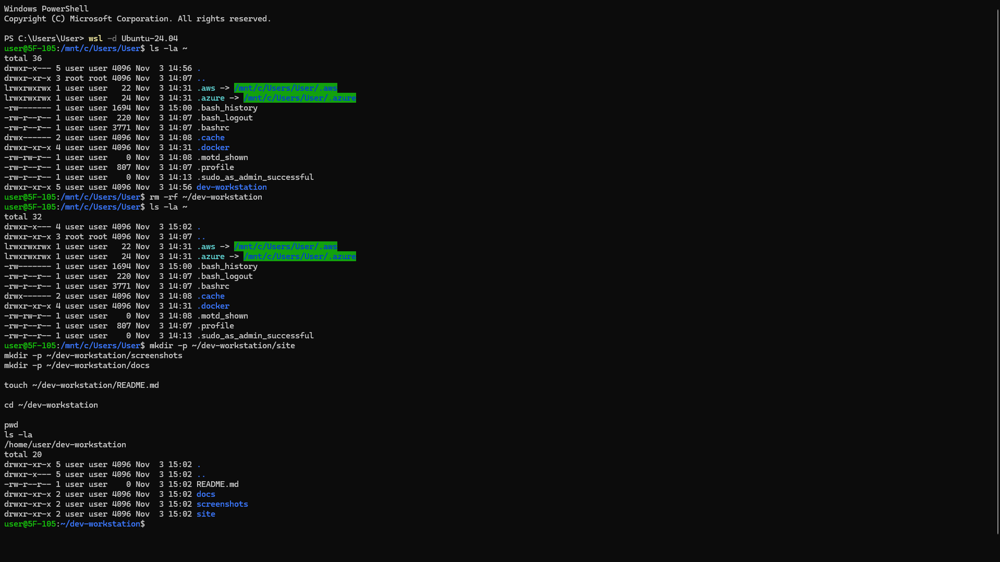
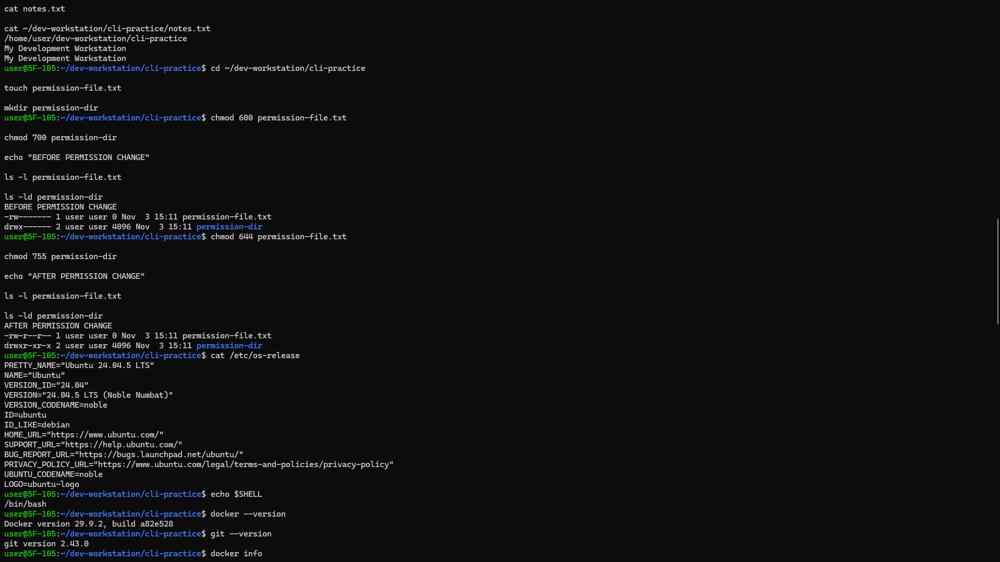
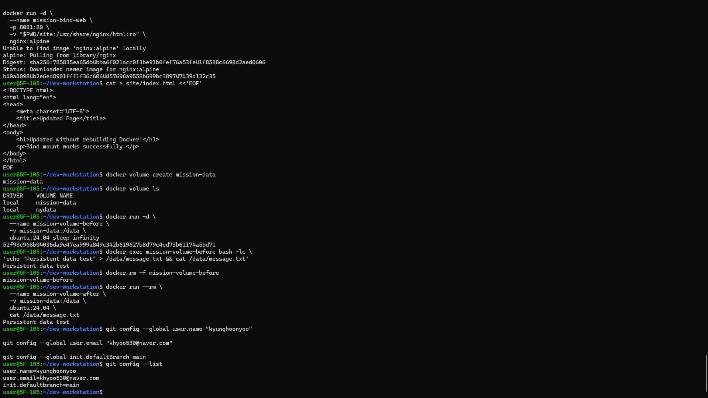

# Development Workstation Setup

## 1. Project Overview

본 프로젝트는 Windows 환경에서 개발자용 워크스테이션을 구축하고 Linux CLI, Docker, Git 및 GitHub의 기본적인 사용 방법을 실습하는 것을 목표로 한다.

WSL 2를 통해 Ubuntu Linux 환경을 구성하고 Docker Desktop을 활용하여 컨테이너 기반 개발 환경을 구축하였다.

주요 수행 내용은 다음과 같다.

- Linux CLI를 활용한 파일 및 디렉토리 관리
- Linux 파일 및 디렉토리 권한 확인 및 변경
- Docker 설치 및 컨테이너 실행
- Dockerfile을 활용한 커스텀 웹 서버 이미지 제작
- Docker Image와 Container의 구조 및 생명주기 차이 이해
- 네트워크 네임스페이스와 포트 매핑 동작 원리 정리
- 포트 매핑을 통한 웹 서버 접속 검증
- 바인드 마운트를 통한 호스트 파일 변경 반영
- Docker 볼륨을 통한 데이터 영속성 검증
- Docker Volume 백업 및 복원 절차 정리
- 포트 충돌 진단 및 해결 절차 정리
- Git 및 GitHub 연동을 통한 소스코드 버전 관리

## 2. Development Environment

| 항목 | 개발 환경 |
|---|---|
| Host OS | Windows |
| Linux Distribution | Ubuntu 24.04.5 LTS |
| Virtualization | WSL 2 |
| Shell | Bash |
| Terminal | Windows PowerShell / WSL |
| Container Platform | Docker Desktop |
| Docker Client | 29.9.2 |
| Docker Server | 29.9.2 |
| Architecture | x86_64 |
| CPUs | 8 |
| Memory | 7.625 GiB |
| Code Editor | Visual Studio Code |
| Git | 2.43.0 |
| Remote Repository | GitHub |

### 2.1 Environment Verification

Ubuntu 운영체제 확인:

```bash
cat /etc/os-release
```

Shell 확인:

```bash
echo $SHELL
```

Docker 버전 확인:

```bash
docker --version
```

실행 결과:

```text
Docker version 29.9.2, build a82e528
```

Docker 엔진 정보 확인:

```bash
docker info
```

Docker Client와 Docker Server가 정상적으로 연결되는 것을 확인하였다.

Git 버전 확인:

```bash
git --version
```

실행 결과:

```text
git version 2.43.0
```

**Verification Evidence**





## 3. Project Structure

```text
dev-workstation/
│
├── README.md
├── Dockerfile
│
├── cli-practice/
│   ├── notes.txt
│   └── permission-file.txt
│
├── site/
│   └── index.html
│
└── screenshots/
    ├── 00-project-setup.png
    ├── 01-terminal-basics.png
    ├── 02-file-operations.png
    ├── 03-file-permissions.png
    ├── 04-development-environment.png
    ├── 05-1-docker-info.png
    ├── 05-2-docker-info.png
    ├── 06-hello-world.png
    ├── 07-ubuntu-container.png
    ├── 08-docker-exec.png
    ├── 09-dockerfile.png
    ├── 10-docker-build.png
    ├── 11-container-running.png
    ├── 12-web-browser.png
    ├── 13-docker-operations.png
    ├── 14-bind-mount-before.png
    ├── 15-bind-mount-after.png
    ├── 16-volume-before.png
    ├── 17-volume-after.png
    ├── 18-git-config.png
    ├── 19-vscode-github-integration.png
    └── 20-github-repository.png
```

## 4. Linux Terminal Practice

Linux CLI를 활용하여 디렉토리 및 파일 관리 작업을 수행하였다.

### 4.1 현재 위치 및 파일 목록 확인

```bash
pwd
ls
ls -la
```

### 4.2 디렉토리 생성 및 이동

```bash
mkdir cli-practice
cd cli-practice
pwd
```

### 4.3 파일 생성 및 내용 확인

```bash
touch notes.txt

echo "My Development Workstation" > notes.txt

cat notes.txt
```

### 4.4 파일 복사, 이동, 이름 변경 및 삭제

```bash
cp notes.txt backup.txt

mkdir archive

mv backup.txt archive/

mv archive/backup.txt archive/final.txt

ls -la archive

rm archive/final.txt
```

### 4.5 절대 경로와 상대 경로

절대 경로는 최상위 디렉토리부터 파일까지의 전체 경로를 의미하며, 상대 경로는 현재 작업 디렉토리를 기준으로 파일 위치를 지정하는 방식이다.

```bash
cat notes.txt

cat ~/dev-workstation/cli-practice/notes.txt
```

두 명령어 모두 동일한 파일에 접근한다.

**Verification Evidence**


## 5. Linux File Permissions

Linux 파일 및 디렉토리의 접근 권한을 확인하고 변경하였다.

### 5.1 실습 파일 생성

```bash
touch permission-file.txt

mkdir permission-dir
```

### 5.2 변경 전 권한

```bash
chmod 600 permission-file.txt

chmod 700 permission-dir

echo "BEFORE PERMISSION CHANGE"

ls -l permission-file.txt

ls -ld permission-dir
```

실행 결과:

```text
-rw------- permission-file.txt
drwx------ permission-dir
```

### 5.3 권한 변경 후 확인

```bash
chmod 644 permission-file.txt

chmod 755 permission-dir

echo "AFTER PERMISSION CHANGE"

ls -l permission-file.txt

ls -ld permission-dir
```

실행 결과:

```text
-rw-r--r-- permission-file.txt
drwxr-xr-x permission-dir
```

### 5.4 Linux Permission 설명

| 권한 | 의미 | 숫자 |
|---|---|---|
| r | Read | 4 |
| w | Write | 2 |
| x | Execute | 1 |

- 644: 소유자는 읽기와 쓰기 권한을 가지며, 그룹 및 기타 사용자는 읽기 권한을 가진다.
- 755: 소유자는 읽기, 쓰기 및 실행 권한을 가지며, 그룹 및 기타 사용자는 읽기 및 실행 권한을 가진다.

권한 변경을 통해 파일과 디렉토리의 접근 권한을 관리하는 방법을 확인하였다.

**Verification Evidence**


## 6. Docker Installation and Verification

Docker Desktop의 WSL 2 백엔드를 활용하여 Docker 실행 환경을 구성하였다.

### 6.1 Docker Version

```bash
docker --version
```

실행 결과:

```text
Docker version 29.9.2, build a82e528
```

### 6.2 Docker Engine Verification

```bash
docker info
```

Docker Client와 Docker Server가 정상적으로 연결되는 것을 확인하였다.

주요 확인 항목:

- Docker Server Version: 29.9.2
- Operating System: Docker Desktop
- Architecture: x86_64
- CPUs: 8
- Total Memory: 약 7.625 GiB

**Verification Evidence**

Docker 엔진 정보는 두 장의 스크린샷으로 기록하였다.


### 6.3 Hello World Container

```bash
docker run hello-world
```

실행 결과:

```text
Hello from Docker!

This message shows that your installation
appears to be working correctly.
```

Docker Hub에서 이미지를 다운로드하고 컨테이너를 생성 및 실행하는 과정을 확인하였다.

**Verification Evidence**


## 7. Docker Container Practice

### 7.1 Ubuntu Container 실행

```bash
docker run -it \
  --name mission-ubuntu-interactive \
  ubuntu:24.04 bash
```

컨테이너 내부에서 다음 명령어를 실행하였다.

```bash
pwd

ls -la

echo "Hello from my Ubuntu container"

exit
```

컨테이너 종료 후 상태를 확인하였다.

```bash
docker ps -a --filter name=mission-ubuntu-interactive
```

컨테이너가 Exited 상태로 변경된 것을 확인하였다.

### 7.2 Docker Exec 실습

백그라운드 컨테이너 실행:

```bash
docker run -d \
  --name mission-ubuntu-background \
  ubuntu:24.04 sleep infinity
```

컨테이너 내부 진입:

```bash
docker exec -it mission-ubuntu-background bash
```

컨테이너 내부에서:

```bash
echo "Testing Docker exec"

exit
```

컨테이너 상태 확인:

```bash
docker ps --filter name=mission-ubuntu-background
```

컨테이너 중지:

```bash
docker stop mission-ubuntu-background

docker ps -a --filter name=mission-ubuntu-background
```

`docker exec`는 실행 중인 컨테이너에 별도의 프로세스를 실행한다. 해당 프로세스에서 `exit`을 입력해도 메인 프로세스가 계속 실행 중이라면 컨테이너는 유지된다.

반면 메인 프로세스가 종료되거나 `docker stop`을 실행하면 컨테이너가 중지된다.

**Verification Evidence**


## 8. Custom Docker Image

기존 NGINX Alpine 이미지를 베이스 이미지로 활용하여 커스텀 웹 서버를 제작하였다.

### 8.1 Base Image

```dockerfile
FROM nginx:alpine
```

### 8.2 Dockerfile

```dockerfile
FROM nginx:alpine

LABEL org.opencontainers.image.title="my-custom-web"

ENV APP_ENV=development

COPY site/ /usr/share/nginx/html/

EXPOSE 80
```

### 8.3 Dockerfile Customization

| 명령어 | 목적 |
|---|---|
| FROM | NGINX Alpine 베이스 이미지 지정 |
| LABEL | 이미지 식별 정보 추가 |
| ENV | 개발 환경 변수 설정 |
| COPY | 직접 작성한 웹페이지를 이미지 내부로 복사 |
| EXPOSE | 컨테이너 서비스 포트 명시 |

`EXPOSE 80`은 컨테이너에서 사용할 서비스 포트를 문서화하는 설정이며, 실제 호스트 포트 연결은 `docker run -p` 옵션을 사용하였다.

### 8.4 Web Server Source Code

`site/index.html`

최초 커스텀 이미지 빌드에 사용한 웹페이지:

```html
<!DOCTYPE html>
<html lang="en">
<head>
    <meta charset="UTF-8">
    <title>My Development Workspace</title>
</head>
<body>
    <h1>Hello, Docker!</h1>
    <p>This is my first custom web server.</p>
</body>
</html>
```

이후 바인드 마운트 실습을 위해 호스트의 `site/index.html`을 수정하였다.

### 8.5 Docker Image Build

```bash
docker build -t mission-web:1.0 .
```

빌드된 이미지 확인:

```bash
docker images
```

커스텀 이미지 `mission-web:1.0`을 생성하였다.

**Verification Evidence**


### 8.6 Docker Image와 Container의 차이

Docker Image와 Container는 서로 연결되어 있지만 역할과 생명주기가 다르다.

**Docker Image**

Docker Image는 컨테이너를 실행하는 데 필요한 애플리케이션 파일, 라이브러리, 의존성 및 설정을 포함하는 읽기 전용 템플릿이다.

- Dockerfile의 `FROM`, `RUN`, `COPY` 등의 명령을 바탕으로 `docker build` 명령이 이미지를 생성한다.
- 이미지는 여러 개의 읽기 전용 파일 시스템 레이어로 구성된다.
- 동일한 이미지를 기반으로 여러 컨테이너를 생성할 수 있다.
- 컨테이너 실행 중 발생한 일반적인 파일 변경은 기존 이미지에 자동으로 반영되지 않는다.
- 이미지의 내용을 변경하려면 일반적으로 Dockerfile을 수정한 뒤 새 이미지를 빌드한다.

**Docker Container**

Container는 Docker Image를 기반으로 생성되어 실제 프로세스를 실행하는 격리된 실행 환경이다.

- `docker create` 또는 `docker run` 명령으로 이미지를 기반으로 컨테이너를 생성한다.
- 컨테이너의 파일 시스템은 이미지의 읽기 전용 레이어 위에 해당 컨테이너만을 위한 쓰기 가능 레이어를 추가한 구조이다.
- 컨테이너 내부에서 발생한 파일 변경은 기본적으로 해당 컨테이너의 쓰기 가능 레이어에 저장된다.
- 컨테이너를 중지해도 컨테이너를 삭제하지 않았다면 해당 쓰기 가능 레이어는 유지된다.
- 컨테이너를 삭제하면 컨테이너의 쓰기 가능 레이어도 삭제된다. 별도로 연결한 Docker Volume이나 Bind Mount의 데이터는 해당 저장소를 별도로 삭제하지 않는 한 유지된다.

**Image와 Container 비교**

| 구분 | Docker Image | Docker Container |
|---|---|---|
| 역할 | 실행 환경의 템플릿 | 이미지를 기반으로 실행되는 인스턴스 |
| 생성 방법 | `docker build` | `docker create` 또는 `docker run` |
| 파일 시스템 | 읽기 전용 이미지 레이어 | 이미지 레이어 + 컨테이너별 쓰기 가능 레이어 |
| 변경 사항 | 실행 중 컨테이너 변경이 이미지에 자동 반영되지 않음 | 컨테이너 내부의 쓰기 가능 영역 변경 가능 |
| 실행 상태 | 자체적으로 프로세스를 실행하지 않음 | 실행, 중지 및 재시작 가능 |
| 삭제 명령 | `docker image rm` | `docker rm` |

**생성·실행·변경 과정**

```text
Dockerfile
   |
   | docker build
   v
Docker Image (읽기 전용 레이어)
   |
   | docker create / docker run
   v
Docker Container (이미지 레이어 + 쓰기 가능 레이어)
   |
   | docker start / docker stop
   v
실행 및 중지 상태 관리
```

`docker run`은 새 컨테이너를 생성하고 시작하는 명령이다. 개념적으로 컨테이너 생성과 시작을 함께 수행한다. 이미 생성된 컨테이너를 다시 실행할 때는 `docker start`를 사용할 수 있다.

이번 프로젝트에서는 다음과 같이 각 단계가 연결된다.

1. `Dockerfile`에서 `FROM nginx:alpine`으로 베이스 이미지를 지정하고 `COPY site/ /usr/share/nginx/html/`로 웹페이지 파일을 이미지에 포함하였다.
2. `docker build -t mission-web:1.0 .` 명령으로 `mission-web:1.0` 이미지를 생성하였다.
3. `docker run` 명령으로 이미지에서 NGINX 컨테이너를 생성하고 실행하였다.
4. 이미지를 빌드한 뒤 호스트의 `site/index.html`을 수정하더라도 기존 이미지 안의 파일은 자동으로 변경되지 않는다.
5. Bind Mount를 연결한 컨테이너에서는 호스트의 `site` 디렉토리가 컨테이너의 `/usr/share/nginx/html` 경로에 마운트되므로, 이미지에 포함된 해당 경로의 파일 대신 마운트된 호스트 파일을 읽는다. 따라서 이미지를 다시 빌드하지 않고도 호스트 파일 변경 사항을 확인할 수 있다.

이처럼 Image는 재사용 가능한 실행 환경을 제공하고, Container는 해당 이미지를 기반으로 실제 프로세스와 컨테이너별 변경 사항을 관리한다.

관련 공식 문서: [Docker - What is an image?](https://docs.docker.com/get-started/docker-concepts/the-basics/what-is-an-image/) · [Docker - Understanding image layers](https://docs.docker.com/get-started/docker-concepts/building-images/understanding-image-layers/)

## 9. Port Mapping and Web Server Access

### 9.1 Container 실행

```bash
docker run -d \
  --name mission-web \
  -p 8080:80 \
  mission-web:1.0
```

### 9.2 Container 상태 확인

```bash
docker ps
```

호스트 포트 8080과 컨테이너 포트 80이 연결된 것을 확인하였다.

### 9.3 Browser Access

웹 브라우저에서 다음 주소에 접속하였다.

```text
http://localhost:8080
```

실행 결과:

```text
Hello, Docker!

This is my first custom web server.
```

### 9.4 Port Mapping 설명

`-p 8080:80`은 호스트의 8080 포트와 컨테이너의 80 포트를 연결하는 설정이다.

이를 통해 호스트 컴퓨터의 웹 브라우저에서 컨테이너 내부 웹 서버에 접근할 수 있다.

**Verification Evidence**


### 9.5 Network Namespace와 Port Forwarding 동작 원리

Docker Container는 호스트와 구분되는 네트워크 환경을 제공하기 위해 Linux Network Namespace를 사용한다. 네트워크 네임스페이스는 컨테이너별 네트워크 인터페이스, IP 주소, 라우팅 테이블 및 네트워크 연결 정보를 분리한다.

Docker의 Bridge Network를 사용하는 일반적인 Linux 환경에서는 컨테이너의 가상 네트워크 인터페이스가 가상 Ethernet 연결을 통해 Docker Bridge에 연결된다. 이를 통해 컨테이너는 독립된 네트워크 환경을 유지하면서 같은 네트워크에 연결된 다른 컨테이너 또는 외부 네트워크와 통신할 수 있다.

**`-p 8080:80`의 의미**

이번 실습에서 사용한 명령어는 다음과 같다.

```bash
docker run -d \
  --name mission-web \
  -p 8080:80 \
  mission-web:1.0
```

`-p HOST_PORT:CONTAINER_PORT` 형식이며, 이 설정은 호스트의 TCP 8080 포트로 들어온 연결을 컨테이너의 TCP 80 포트로 전달하도록 Docker에 요청한다. `EXPOSE 80`은 이미지의 서비스 포트를 문서화하는 설정이며, 그 자체로 호스트 포트를 공개하지 않는다. 실제 포트 공개는 `-p` 또는 `--publish` 옵션으로 설정한다.

**이번 Windows + WSL 2 + Docker Desktop 환경에서의 요청 흐름**

1. Windows에서 실행한 브라우저가 `http://localhost:8080`으로 HTTP 요청을 보낸다.
2. Docker Desktop의 Windows 네트워크 백엔드(`com.docker.backend.exe`)가 공개된 호스트 포트의 연결을 수신한다.
3. Docker Desktop이 해당 연결을 Docker Engine이 실행되는 Linux 가상 환경으로 전달한다.
4. Linux 환경의 Docker 네트워크가 요청을 대상 컨테이너의 내부 IP 주소와 80 포트로 전달한다.
5. 컨테이너 내부의 NGINX 프로세스가 HTTP 요청을 처리한다.
6. 응답은 같은 네트워크 전달 경로를 거쳐 Windows 호스트의 브라우저로 돌아온다.

**Linux Docker Engine의 Bridge Network와 포트 공개**

일반적인 Linux Docker Engine의 Bridge Network에서는 공개된 호스트 포트와 컨테이너 포트 사이의 전달을 위해 Docker가 방화벽 및 NAT/PAT 규칙 등을 설정한다. 실제 세부 경로는 운영체제, Docker 설정 및 네트워크 모드에 따라 달라질 수 있다. Docker Desktop의 Windows 환경에서는 Windows 호스트와 Linux 가상 환경 사이의 전달을 Docker Desktop 백엔드가 담당하므로, Windows에서 Linux 호스트의 네트워크 규칙이 그대로 직접 적용되는 것으로 이해하면 안 된다.

참고로 `-p 8080:80`처럼 호스트 IP를 지정하지 않으면 기본적으로 모든 호스트 네트워크 인터페이스에 포트를 공개할 수 있다. 로컬 컴퓨터에서만 접근하도록 제한하려면 다음처럼 `127.0.0.1`을 명시할 수 있다.

```bash
docker run -d \
  --name mission-web-local \
  -p 127.0.0.1:8083:80 \
  mission-web:1.0
```

**추가 검증 명령어**

```bash
# 컨테이너의 호스트-컨테이너 포트 매핑 확인
docker port mission-web

# Docker 네트워크 목록 확인
docker network ls

# 기본 bridge 네트워크의 상세 정보 확인
docker network inspect bridge

# 브라우저 없이 HTTP 응답 확인
curl -i http://localhost:8080
```

`docker port`는 컨테이너에 설정된 포트 매핑을 확인하고, `docker network inspect`는 네트워크 구성과 연결 정보를 확인한다. `curl`은 브라우저를 사용하지 않고 HTTP 상태 코드와 응답 헤더 및 본문을 확인하는 데 사용한다.

관련 공식 문서: [Docker - Port publishing and mapping](https://docs.docker.com/engine/network/port-publishing/) · [Docker Desktop - Networking](https://docs.docker.com/desktop/features/networking/)

## 10. Docker Operations

Docker 이미지, 컨테이너, 로그 및 리소스 확인 명령어를 실습하였다.

### 10.1 Images

```bash
docker images
```

### 10.2 Containers

```bash
docker ps

docker ps -a
```

### 10.3 Container Logs

```bash
docker logs mission-web
```

### 10.4 Resource Usage

```bash
docker stats --no-stream mission-web
```

각 명령어를 통해 이미지 목록, 컨테이너 실행 상태, 로그 및 리소스 사용량을 확인하였다.

**Verification Evidence**


## 11. Bind Mount Verification

바인드 마운트를 활용하여 호스트 컴퓨터의 파일 변경 사항이 컨테이너에 반영되는 것을 검증하였다.

### 11.1 Bind Mount Container 실행

```bash
cd ~/dev-workstation

docker run -d \
  --name mission-bind-web \
  -p 8081:80 \
  -v "$PWD/site:/usr/share/nginx/html:ro" \
  nginx:alpine
```

### 11.2 변경 전 확인

브라우저 접속:

```text
http://localhost:8081
```

기존 웹페이지의 내용을 확인하였다.

### 11.3 호스트 파일 수정

`site/index.html`의 내용을 다음과 같이 수정하였다.

```html
<!DOCTYPE html>
<html lang="en">
<head>
    <meta charset="UTF-8">
    <title>Updated Page</title>
</head>
<body>
    <h1>Updated without rebuilding Docker!</h1>
    <p>Bind mount works successfully.</p>
</body>
</html>
```

### 11.4 변경 후 확인

브라우저를 새로고침하여 수정된 내용을 확인하였다.

Docker 이미지를 다시 빌드하지 않고도 호스트 파일의 변경 사항이 컨테이너에 반영되었다.

### 11.5 Bind Mount 설명

바인드 마운트는 호스트 컴퓨터의 특정 경로를 컨테이너 내부의 경로에 연결하는 기능이다.

이번 실습에서는 `:ro` 옵션을 사용하여 컨테이너에서 해당 마운트 경로를 읽기 전용으로 연결하였다.

호스트에서 파일을 수정하면 컨테이너에서도 변경 사항을 확인할 수 있다.

**Verification Evidence**

변경 전:


변경 후:


## 12. Docker Volume Persistence

Docker 볼륨을 생성하고 컨테이너에 연결하여 데이터 영속성을 검증하였다.

### 12.1 Volume 생성

```bash
docker volume create mission-data

docker volume ls
```

### 12.2 Volume을 연결한 Container 실행

```bash
docker run -d \
  --name mission-volume-before \
  -v mission-data:/data \
  ubuntu:24.04 sleep infinity
```

### 12.3 데이터 생성 및 확인

```bash
docker exec mission-volume-before bash -lc \
'echo "Persistent data test" > /data/message.txt && cat /data/message.txt'
```

실행 결과:

```text
Persistent data test
```

### 12.4 기존 Container 삭제

```bash
docker rm -f mission-volume-before
```

### 12.5 새로운 Container에서 데이터 확인

```bash
docker run --rm \
  --name mission-volume-after \
  -v mission-data:/data \
  ubuntu:24.04 \
  cat /data/message.txt
```

실행 결과:

```text
Persistent data test
```

기존 컨테이너를 삭제하고 새로운 컨테이너를 생성한 후에도 동일한 데이터가 유지되는 것을 확인하였다.

### 12.6 Volume 설명

Docker Volume은 컨테이너와 독립적으로 데이터를 저장하는 기능이다.

컨테이너가 삭제되더라도 볼륨 자체가 삭제되지 않는 한 저장된 데이터를 유지할 수 있다.

**Verification Evidence**

데이터 저장 및 기존 컨테이너:


기존 컨테이너 삭제 후 데이터 확인:


### 12.7 Volume Backup and Restore

Docker Volume은 컨테이너와 독립적으로 데이터를 유지하지만, 볼륨 삭제나 데이터 손상에 대비하려면 별도의 백업이 필요하다. Docker에서는 임시 컨테이너에 대상 볼륨과 호스트 백업 디렉토리를 연결한 뒤 `tar`로 데이터를 압축하는 방식으로 백업 및 복원을 수행할 수 있다.

이번 실습에서 생성한 `mission-data` 볼륨을 대상으로 백업하고, 별도의 새 볼륨에 복원하는 절차는 다음과 같다.

> 아래 명령은 WSL Ubuntu의 Bash 터미널에서 실행한다. `BACKUP_DIR` 및 `BACKUP_FILE` 변수는 이어지는 명령에서 사용하므로 같은 터미널 세션에서 순서대로 실행한다. 백업 파일은 실수로 GitHub에 업로드하지 않도록 프로젝트 디렉토리 바깥인 `$HOME/docker-volume-backups`에 저장한다.

**1. 백업 디렉토리 및 파일명 준비**

```bash
BACKUP_DIR="$HOME/docker-volume-backups"
mkdir -p "$BACKUP_DIR"

BACKUP_FILE="mission-data-$(date +%Y%m%d-%H%M%S).tar.gz"
```

**2. Docker Volume 백업**

```bash
docker run --rm \
  -v mission-data:/source:ro \
  -v "$BACKUP_DIR:/backup" \
  ubuntu:24.04 \
  tar -czf "/backup/$BACKUP_FILE" -C /source .
```

명령어의 주요 옵션은 다음과 같다.

- `mission-data:/source:ro`: 기존 Docker Volume을 임시 컨테이너의 `/source` 경로에 읽기 전용으로 연결한다.
- `"$BACKUP_DIR:/backup"`: WSL 호스트의 백업 디렉토리를 임시 컨테이너의 `/backup` 경로에 연결한다.
- `tar -czf`: 볼륨 내부 파일을 gzip 형식의 tar 아카이브로 압축한다.
- `--rm`: 백업 작업이 끝나면 임시 컨테이너를 자동으로 삭제한다.

**3. 백업 파일 확인**

```bash
ls -lh "$BACKUP_DIR/$BACKUP_FILE"
tar -tzf "$BACKUP_DIR/$BACKUP_FILE"
```

`ls -lh`로 백업 파일의 존재 및 크기를 확인하고, `tar -tzf`로 아카이브 내부의 파일 목록을 확인한다. 이번 볼륨에는 앞선 실습에서 생성한 `message.txt`가 포함되어 있어야 한다.

**4. 복원 대상 Volume 생성**

원본 볼륨을 덮어쓰지 않고 별도의 볼륨을 생성하여 복원한다.

```bash
RESTORE_VOLUME="mission-data-restore-$(date +%Y%m%d-%H%M%S)"
docker volume create "$RESTORE_VOLUME"
```

**5. 백업 파일을 새 Volume에 복원**

```bash
docker run --rm \
  -v "$RESTORE_VOLUME:/target" \
  -v "$BACKUP_DIR:/backup:ro" \
  ubuntu:24.04 \
  tar -xzf "/backup/$BACKUP_FILE" -C /target
```

`tar -xzf`는 백업 아카이브의 내용을 새 볼륨의 `/target` 경로에 압축 해제한다. 백업 디렉토리는 복원 컨테이너에서 읽기 전용으로 연결한다.

**6. 복원 데이터 검증**

```bash
docker run --rm \
  -v "$RESTORE_VOLUME:/data:ro" \
  ubuntu:24.04 \
  cat /data/message.txt
```

예상되는 내용은 원래 볼륨에 저장한 다음 문자열이다.

```text
Persistent data test
```

실제 실행 결과가 위 내용과 일치하는지 확인한다. 복원 볼륨의 상세 정보는 다음 명령어로 확인할 수 있다.

```bash
docker volume inspect "$RESTORE_VOLUME"
```

**Backup and Restore 주의사항**

- 이 절차는 볼륨에 저장된 파일을 아카이브로 복사하는 기본적인 백업 방법이다.
- 데이터베이스처럼 백업 중에도 데이터가 계속 변경되는 서비스는 데이터 일관성을 확보해야 한다. 애플리케이션을 일시 중지하거나 데이터베이스가 제공하는 논리 백업 또는 스냅샷 기능을 함께 사용하는 것이 좋다.
- 백업 파일은 원본 데이터와 다른 저장 위치에도 복사하고, 실제 복원 테스트를 통해 백업 파일이 사용 가능한지 확인해야 한다.
- 복원 예제는 원본 `mission-data`를 변경하지 않고 새 볼륨에 데이터를 복구한다. 복원이 성공적으로 확인된 이후에 기존 데이터와 교체할지 결정한다.

관련 공식 문서: [Docker - Volumes: Back up, restore, or migrate data volumes](https://docs.docker.com/engine/storage/volumes/#back-up-restore-or-migrate-data-volumes)

## 13. Git and GitHub Integration

Git을 사용하여 로컬 프로젝트의 버전을 관리하고 GitHub에 원격 저장소를 연결하였다.

### 13.1 Git 사용자 정보 및 기본 브랜치 설정

```bash
git config --global user.name "kyunghoonyoo"

git config --global user.email "khyoo530@naver.com"

git config --global init.defaultBranch main
```

설정 확인:

```bash
git config --list
```

실제 Git 사용자 정보와 기본 브랜치 설정이 정상적으로 적용된 것을 확인하였다.

**Verification Evidence**



### 13.2 Git Repository 초기화

```bash
git init

git branch -M main

git add .

git commit -m "Complete development workstation mission"
```

### 13.3 GitHub Repository 연결

GitHub Repository:

https://github.com/kyunghoonyoo/dev-workstation

원격 저장소 연결:

```bash
git remote add origin https://github.com/kyunghoonyoo/dev-workstation.git
```

원격 저장소 확인:

```bash
git remote -v
```

현재 브랜치 확인:

```bash
git branch --show-current
```

원격 저장소에 업로드:

```bash
git push -u origin main
```

### 13.4 GitHub Authentication

HTTPS 방식의 Git 작업을 위해 GitHub CLI를 사용하여 브라우저 기반 인증을 진행하였다.

```bash
gh auth login

gh auth status

gh auth setup-git
```

인증 완료 후 GitHub 원격 저장소에 정상적으로 Push할 수 있었다.

### 13.5 Git과 GitHub의 차이

- Git: 로컬 컴퓨터에서 소스코드의 변경 사항과 버전을 관리하는 분산 버전 관리 시스템이다.
- GitHub: Git 저장소를 원격으로 호스팅하고 프로젝트 공유 및 협업을 지원하는 플랫폼이다.

### 13.6 VS Code and GitHub Integration

Visual Studio Code에서 GitHub 계정으로 로그인하고 프로젝트 저장소를 열었다.

Source Control 패널에서 Git 저장소를 확인하고 통합 터미널에서 원격 저장소 주소, 브랜치 및 Git 상태를 확인하였다.

**Verification Evidence**

VS Code GitHub 로그인 및 Source Control 통합 화면:


GitHub Repository:

https://github.com/kyunghoonyoo/dev-workstation


## 14. Troubleshooting

실습 과정에서 발생한 문제와 해결 과정을 정리하였다.

### 14.1 WSL Update HTTP 403 Error

**Problem**

WSL 업데이트 실행 중 HTTP 403 오류가 발생하였다.

```text
사용 권한 없음(403).
오류 코드: Wsl/UpdatePackage/HTTP_E_STATUS_FORBIDDEN
```

**Cause Hypothesis**

WSL 업데이트 패키지 다운로드 과정에서 네트워크 정책 또는 업데이트 서버 접근이 제한되었을 가능성이 있다.

**Verification**

```powershell
wsl --list --verbose
```

Ubuntu-24.04가 WSL Version 2로 설치되어 실행되는 것을 확인하였다.

추가로 Docker Client와 Server가 정상적으로 연결되고 Docker 컨테이너가 실행되는 것을 확인하였다.

**Resolution / Alternative**

WSL 업데이트 오류의 정확한 발생 원인은 확인하지 못하였다. 기존 WSL 2 환경에서 Docker가 정상적으로 작동하는 것을 확인하여 해당 환경을 활용해 실습을 진행하였다.

### 14.2 Docker Container Name Conflict

**Problem**

Ubuntu 컨테이너 실행 시 기존 컨테이너 이름과 충돌하였다.

```text
The container name "/ubuntu-lab" is already in use
```

**Cause**

동일한 이름을 가진 컨테이너가 이미 존재하였다.

**Verification**

```bash
docker ps -a
```

**Resolution**

기존 컨테이너를 임의로 삭제하지 않고 새로운 고유 이름을 사용하였다.

```bash
docker run -it \
  --name mission-ubuntu-interactive \
  ubuntu:24.04 bash
```

이를 통해 기존 컨테이너와의 이름 충돌을 방지하였다.

### 14.3 GitHub Authentication Failed

**Problem**

GitHub Push 과정에서 계정 비밀번호 인증이 거부되었다.

```text
Invalid username or token.
Password authentication is not supported for Git operations.
```

**Cause**

GitHub는 HTTPS Git 작업에서 일반 계정 비밀번호를 이용한 인증을 지원하지 않는다.

**Resolution**

GitHub CLI를 설치하고 브라우저 기반 인증을 진행하였다.

```bash
gh auth login

gh auth status

gh auth setup-git
```

인증 완료 후 Git Push를 다시 진행하였다.

### 14.4 Git Push Rejected

**Problem**

로컬 저장소를 GitHub에 Push할 때 원격 저장소의 기존 커밋으로 인해 업로드가 거부되었다.

```text
Updates were rejected because the remote contains work
that you do not have locally.
```

**Cause**

GitHub 원격 저장소에 로컬 저장소에 존재하지 않는 별도의 커밋이 있었다.

**Resolution**

원격 저장소의 기록을 가져와 로컬 저장소와 병합하였다.

```bash
git pull --no-rebase origin main --allow-unrelated-histories
```

병합을 완료한 후 다시 Push하였다.

```bash
git push -u origin main
```

이를 통해 로컬 저장소와 원격 저장소의 기록을 통합하였다.

### 14.5 Docker Port Conflict

**Problem**

Docker Container를 실행할 때 지정한 호스트 포트를 다른 컨테이너 또는 호스트 프로세스가 이미 사용하고 있으면 포트 바인딩에 실패할 수 있다. 예를 들어 8080 포트를 사용할 수 없는 경우 Docker가 다음과 유사한 오류를 출력할 수 있다.

```text
Bind for 0.0.0.0:8080 failed: port is already allocated
```

위 오류는 포트 충돌 상황의 예시이며, 실제 오류 문구는 Docker 버전과 실행 환경에 따라 다를 수 있다.

**Cause Hypothesis**

- 다른 Docker 컨테이너가 이미 동일한 호스트 포트를 공개하고 있을 수 있다.
- Windows 또는 WSL에서 실행 중인 다른 프로그램이 해당 포트를 사용하고 있을 수 있다.
- Docker Desktop의 포트 전달 또는 네트워크 백엔드가 기존 포트 바인딩을 유지하고 있을 수 있다.

**Verification 1 - Docker Container 확인**

먼저 실행 중인 컨테이너와 포트 매핑을 확인한다.

```bash
docker ps --format 'table {{.Names}}\t{{.Ports}}'
```

모든 컨테이너 상태를 확인하려면 다음 명령어를 사용할 수 있다.

```bash
docker ps -a
```

해당 포트를 사용 중인 컨테이너가 확인되면 컨테이너 이름과 용도를 확인한 다음 필요한 경우 정상적으로 중지한다.

```bash
# 예시: 확인한 컨테이너가 mission-web인 경우
docker stop mission-web
```

실제 실행 시에는 `docker ps`에서 확인한 컨테이너 이름을 사용한다. 해당 컨테이너가 사용 중인 서비스인지 확인한 뒤 중지한다.

**Verification 2 - Windows Host 확인**

Docker Desktop을 사용하는 Windows 환경에서는 PowerShell에서 호스트 포트를 점유한 프로세스를 확인한다.

```powershell
Get-NetTCPConnection -LocalPort 8080 -State Listen -ErrorAction SilentlyContinue |
  Select-Object LocalAddress, LocalPort, OwningProcess
```

확인된 PID의 프로세스 이름을 조회한다.

```powershell
$connections = Get-NetTCPConnection -LocalPort 8080 -State Listen -ErrorAction SilentlyContinue
$connections | ForEach-Object { Get-Process -Id $_.OwningProcess }
```

대체 확인 방법으로 다음 명령어도 사용할 수 있다.

```powershell
netstat -ano | findstr ":8080 "
```

`netstat` 결과의 마지막 열은 PID이며, 해당 PID를 `Get-Process -Id` 명령에 전달하여 프로세스를 확인할 수 있다.

**Verification 3 - WSL 내부 확인**

WSL Ubuntu에서는 `ss` 명령어로 해당 포트를 사용하는 리스닝 소켓을 확인한다.

```bash
sudo ss -ltnp 'sport = :8080'
```

`lsof`가 설치되어 있다면 다음 명령어도 사용할 수 있다.

```bash
sudo lsof -nP -iTCP:8080 -sTCP:LISTEN
```

Windows 호스트의 포트 상태와 WSL 내부의 포트 상태는 동일한 목록이라고 가정하면 안 된다. Docker Desktop의 Windows 호스트 포트 충돌은 PowerShell 명령으로 우선 확인하고, WSL 내부 서비스 충돌은 WSL의 `ss` 또는 `lsof`로 확인한다.

**Resolution**

1. 포트를 점유한 항목이 다른 Docker 컨테이너라면 실제 사용 여부를 확인한 후 해당 컨테이너를 중지한다.
2. Windows 또는 WSL의 일반 프로세스라면 프로세스 이름과 용도를 확인한다. 필요한 프로그램은 정상적인 종료 방법을 사용한다.
3. 프로세스를 종료해도 되는 것이 확실한 경우에만 해당 프로세스를 종료한다. 원인을 확인하지 않은 채 시스템 프로세스나 Docker Desktop 백엔드 프로세스를 강제 종료하지 않는다.
4. 기존 서비스가 해당 포트를 계속 사용해야 한다면 Docker 컨테이너에 다른 호스트 포트를 할당한다.

예를 들어 호스트 포트 8080 대신 8082를 사용하려면 다음과 같이 실행할 수 있다.

```bash
docker run -d \
  --name mission-web-alt \
  -p 8082:80 \
  mission-web:1.0
```

**Verification After Resolution**

```bash
docker ps --filter name=mission-web-alt
docker port mission-web-alt
curl -i http://localhost:8082
```

`curl` 명령으로 HTTP 응답이 반환되는지 확인한다. 테스트 컨테이너가 더 이상 필요하지 않다면 다음 명령으로 정리할 수 있다.

```bash
docker rm -f mission-web-alt
```

**Lesson Learned**

포트 충돌이 발생했을 때 무조건 Docker를 재설치하거나 컨테이너를 삭제하는 대신, Docker 컨테이너와 Windows/WSL 프로세스를 구분하여 점유 현황을 확인해야 한다. 원인을 확인한 뒤 기존 서비스를 안전하게 중지하거나 다른 호스트 포트를 지정하는 것이 올바른 진단 및 해결 절차이다.

## 15. Final Verification Checklist

- [x] Linux CLI 기본 명령어 실습
- [x] 디렉토리 생성 및 이동
- [x] 파일 생성, 내용 확인, 복사, 이동, 삭제
- [x] 절대 경로와 상대 경로 이해
- [x] 파일 권한 확인 및 변경
- [x] Docker 버전 확인
- [x] Docker 엔진 상태 확인
- [x] hello-world 실행
- [x] Ubuntu 컨테이너 실행 및 내부 명령어 실습
- [x] Docker 컨테이너 실행 및 종료 방식 확인
- [x] Docker 이미지 및 컨테이너 운영 명령어
- [x] Dockerfile 직접 작성
- [x] NGINX 기반 커스텀 이미지 빌드
- [x] 컨테이너 실행
- [x] 포트 매핑 및 브라우저 접속 검증
- [x] 바인드 마운트 변경 사항 반영 검증
- [x] Docker 볼륨 데이터 영속성 검증
- [x] Git 사용자 정보 및 기본 브랜치 설정
- [x] GitHub 원격 저장소 연결
- [x] VS Code GitHub 로그인 및 저장소 연동
- [x] 수행 결과 및 스크린샷 정리
- [x] 트러블슈팅 기록
- [x] Docker Image와 Container의 구조 및 생명주기 차이 설명
- [x] Network Namespace와 Port Forwarding 원리 설명
- [x] Docker Volume 백업 및 복원 절차 문서화
- [x] Docker Port Conflict 진단 및 해결 절차 문서화

## 16. Conclusion

이번 미션을 통해 Windows 환경에서 WSL 2와 Ubuntu를 활용한 Linux 개발 환경을 구축하고 Docker 및 GitHub를 이용한 기본적인 개발 워크플로를 실습하였다.

Dockerfile을 이용한 커스텀 이미지 빌드와 컨테이너 실행을 진행하고, 포트 매핑을 통한 웹 서버 접근, 바인드 마운트를 통한 호스트 파일 변경 반영, Docker Volume을 통한 데이터 영속성을 확인하였다.

추가로 Docker Image와 Container의 파일 시스템 및 생명주기 차이, Network Namespace와 Port Forwarding의 동작 원리를 정리하였다. 또한 포트 충돌 발생 시 점유 프로세스를 확인하고 해결하는 진단 절차와 Docker Volume의 백업 및 복원 방법을 README에 보완하여 문서화하였다.

또한 Git을 활용한 로컬 버전 관리와 GitHub를 통한 원격 저장소 연동을 경험하였다.

이번 실습을 통해 개발 환경을 구성하는 것뿐 아니라 실행 결과를 검증하고, 문제 발생 시 원인을 진단하며, 데이터를 보존하는 기본적인 개발 및 운영 절차를 학습하였다.

---

**GitHub Repository:**

https://github.com/kyunghoonyoo/dev-workstation
